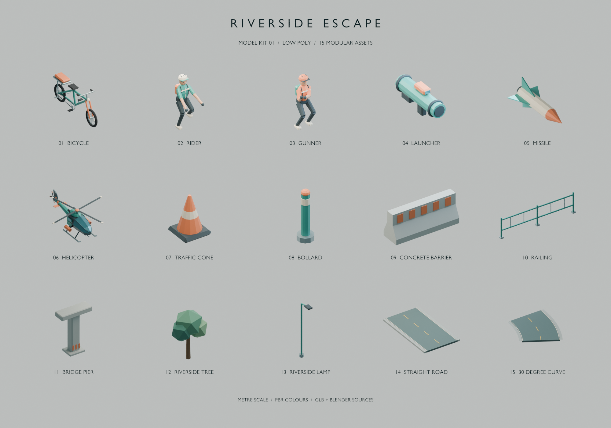
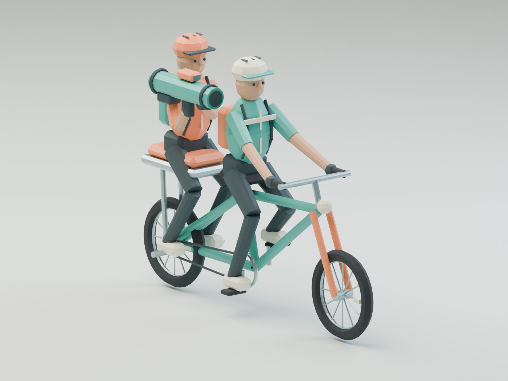
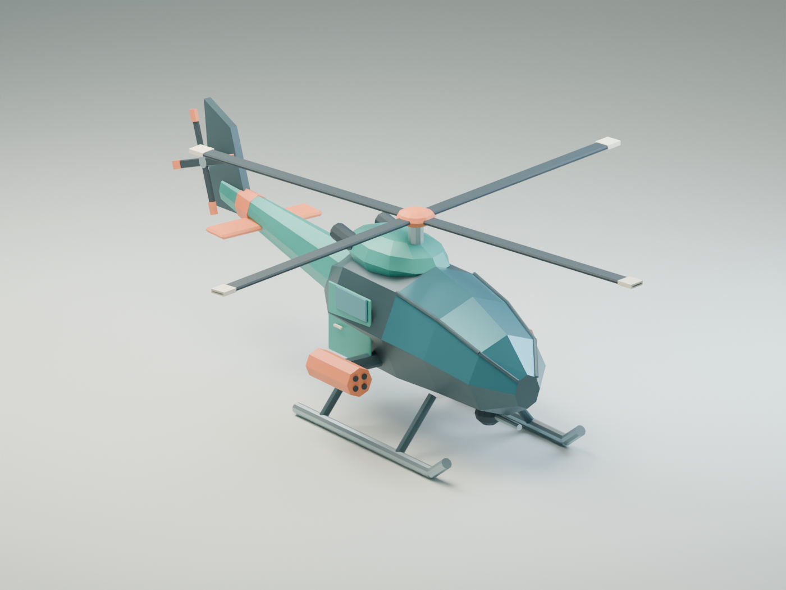
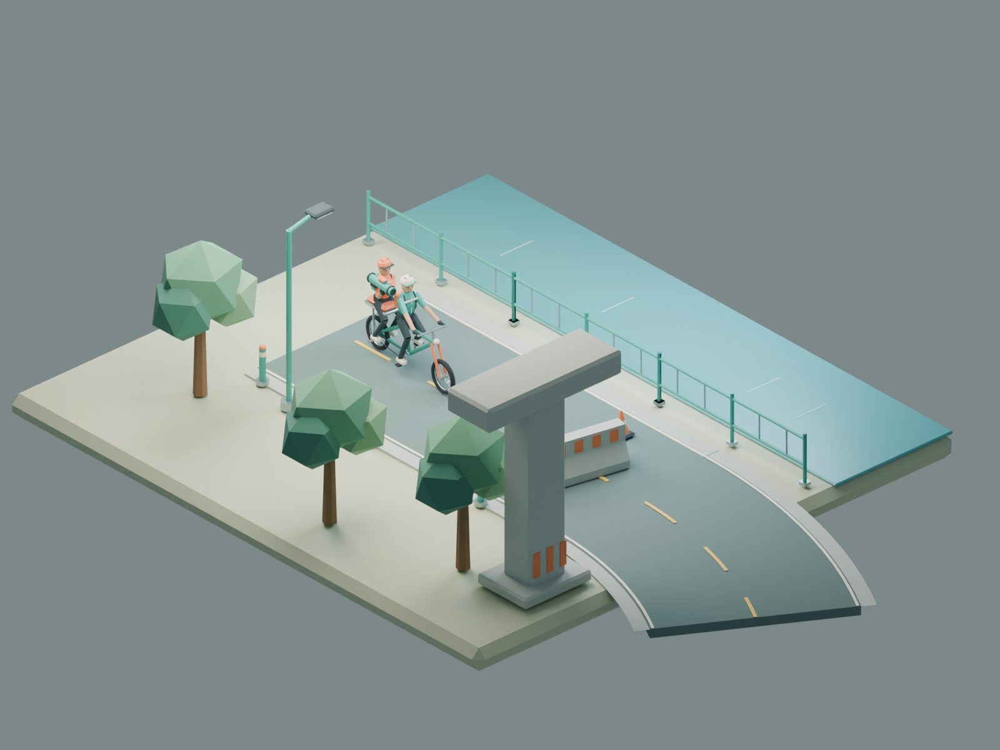

# Riverside Escape — Model Kit 01

第一批風格化低多邊形模型，以青綠、橘色、米白與深灰形成一致識別。
全部為本專案建立的原創程序式幾何，沒有使用第三方模型、圖片貼圖或外部材質。



目錄為便於辨識，逐項縮放至格子內；共乘與河濱組裝預覽則使用實際公尺比例。

## 交付檔案

- `riverside_models.blend`：Blender 5.2 原始檔。切換 Scene 可檢視模型庫、共乘組裝、直升機、河濱示意場景及模型目錄。
- `../assets/models/*.glb`：15 個獨立 glTF 2.0 模型，每個檔案只有自己的模型、材質與節點。
- `../assets/models/manifest.json`：實際三角形數、大小、包圍盒與掛點。掛點位置及四元數為 **asset-local、glTF 座標**；`parent` 表示實際節點父子關係，不能把這些 asset-local 數值當成 parent-local 使用。
- `previews/`：由 Blender 渲染的組裝預覽，不是遊戲執行畫面。
- `validation/`：Khronos glTF Validator 與 Blender 匯入回讀驗證報告。

| 模型 | 用途／原點 |
|---|---|
| `bicycle.glb` | 長尾雙座自行車；原點在地面、接近曲柄位置 |
| `rider.glb` | 青綠外套騎士，坐姿；原點為骨盆／座位接點 |
| `gunner.glb` | 橘色外套射手，坐姿；原點為骨盆／座位接點 |
| `launcher.glb` | 虛構遊戲鎖定發射器；原點為筒身中心 |
| `missile.glb` | 遊戲化投射物；原點為彈體中心，附尾焰掛點 |
| `helicopter.glb` | 追擊直升機；原點在滑橇接地高度 |
| `traffic_cone.glb` | 交通錐，底部原點 |
| `bollard.glb` | 河濱阻車柱，底部原點 |
| `concrete_barrier.glb` | 2 m 寬混凝土護欄，底部中央原點 |
| `railing.glb` | 4 m 河岸欄杆，底部中央原點 |
| `bridge_pier.glb` | 橋墩與橫向頂梁，底部中央原點 |
| `riverside_tree.glb` | 低多邊形闊葉樹，樹幹底部原點 |
| `riverside_lamp.glb` | 河濱路燈，燈柱底部原點 |
| `road_straight.glb` | 4 m 車道寬、8 m 長的直線路段，入口地面原點 |
| `road_curve.glb` | 4 m 車道寬、中心半徑 10 m 的右轉 30° 路段，入口地面原點 |

道路的 4 m 不含左右各 0.3 m 的路肩。橋墩是模組，不是完整橋樑或關卡。

## 座標、組裝與可動節點

1 Blender unit = 1 m。Blender 使用 **+Y 前、+Z 上、+X 右**；輸出 GLB 轉為 **-Z 前、+Y 上、+X 右**。
各 GLB 根節點為 `<asset>.Root`，位移為零、縮放為 1。模型庫 Scene 只為編輯方便排成網格；GLB 仍以各自原點輸出。
若從模型庫手動匯出，先把該模型的 Root 位移設回 `(0, 0, 0)`，僅選取此模型的完整階層匯出；不要把展示用網格位移或其他模型一起輸出。



把 `rider.Root` 以 identity local transform 掛在 `bicycle.Seat_Rider`，
`gunner.Root` 掛在 `bicycle.Seat_Gunner`；把 `launcher.Root` 掛在 `gunner.WeaponMount`。
掛點和角色視覺是自行車的子節點，沿用單一車體物理位置；不要把兩位乘員變成獨立物理車輛。

| 節點 | GLB 局部旋轉軸／用途 |
|---|---|
| `bicycle.Steering` | Y 軸轉向，前叉、把手與前輪會一起轉動 |
| `bicycle.WheelFront` / `WheelRear` | X 軸轉動；輪半徑約 0.349 m |
| `bicycle.Crank` | X 軸踏板曲柄 |
| `bicycle.Seat_Rider` / `Seat_Gunner` | 分別為騎士／射手掛點 |
| `rider.Camera_Aim` / `gunner.Camera_Aim` | 視線參考位置；鏡頭的平滑與穩定由遊戲邏輯決定 |
| `gunner.Torso` | 可獨立旋轉上半身；武器掛點隨之轉動 |
| `gunner.WeaponMount` | 發射器掛點 |
| `launcher.Muzzle` / `missile.Exhaust` | 發射／尾焰參考位置 |
| `helicopter.MainRotor` | Y 軸主旋翼 |
| `helicopter.TailRotor` | X 軸尾旋翼 |
| `helicopter.TurretYaw` / `TurretPitch` | 分別為 Y 軸方位、X 軸俯仰 |
| `helicopter.TargetLock` / `Muzzle` | 鎖定目標中心／機鼻砲口 |
| `road_*.Entry` / `Exit` | 沿出口的完整 transform 拼接下一段入口，包含彎道出口方向 |

角色為可修改坐姿的**剛性分節模型**，保留肩、肘、髖、膝與頭部節點；目前沒有蒙皮骨架、IK、踩踏或受擊動畫片段。
旋翼與輪子同樣保留轉軸，供之後程式控制。碰撞體、碰撞資料、傷害與武器行為尚未實作。



## 遊戲整合

Bevy `AssetServer` 的模型路徑可使用 `models/bicycle.glb#Scene0`（其他檔案同理）。
目前只交付素材，沒有修改 Rust app 去生成場景。
從 workspace 根目錄啟動原生 client 時使用 `BEVY_ASSET_ROOT="$PWD" cargo run -p riverside-client`。
`web/index.html` 已加入 Trunk 的 `copy-dir`，下一次建置會把 GLB 複製到 `dist/assets/models/`。

材質使用標準不透明 PBR 顏色、metallic 與 roughness，沒有貼圖或特殊 shader。
玻璃是風格化不透明色塊，避免需要玻璃透射材質。
同父節點及材質的靜態幾何會合併；需要動作的節點則保留。
目前只有一級模型，沒有額外 LOD、碰撞 mesh 或 Draco／Meshopt 壓縮。

格式與匯入回讀已驗證；Bevy／瀏覽器內的實際光照、剔除、動畫和效能仍需在場景接入時驗證。
匯出方式參考 [Blender 官方 glTF 說明](https://docs.blender.org/manual/en/5.1/addons/import_export/scene_gltf2.html)。



## 重建與驗證

在 workspace 根目錄執行：

```sh
# 重新產生 GLB、manifest、Blender 原始檔與所有預覽。
blender -b --factory-startup --python-exit-code 1 --python tools/build_models.py -- --render

# 省略渲染，快速重建模型；既有預覽不會自動更新。
blender -b --factory-startup --python-exit-code 1 --python tools/build_models.py

# 只重新渲染指定預覽，其餘模型與 Blender 原始檔仍會重建。
blender -b --factory-startup --python-exit-code 1 --python tools/build_models.py -- --render-only bicycle_crew.png

# 每個 GLB 重新匯入，檢查幾何數量、尺寸、父子關係和掛點 transform。
blender -b --factory-startup --python-exit-code 1 --python tools/validate_models.py

# 可選的官方 Khronos 格式驗證；工具安裝到暫存目錄，不修改 Rust 專案依賴。
model_validator_dir=$(mktemp -d)
npm install --prefix "$model_validator_dir" --ignore-scripts gltf-validator@2.0.0-dev.3.10
NODE_PATH="$model_validator_dir/node_modules" node tools/validate_gltf.cjs
```

產生器會覆寫這一套同名輸出。若在 Blender 手動修改，請先另存成自己的工作檔，再決定要更新產生器還是手動重新匯出。
美術原始檔與預覽留在 `art/`；Trunk 只複製 `assets/`，不會把 `.blend` 或預覽包進遊戲。
