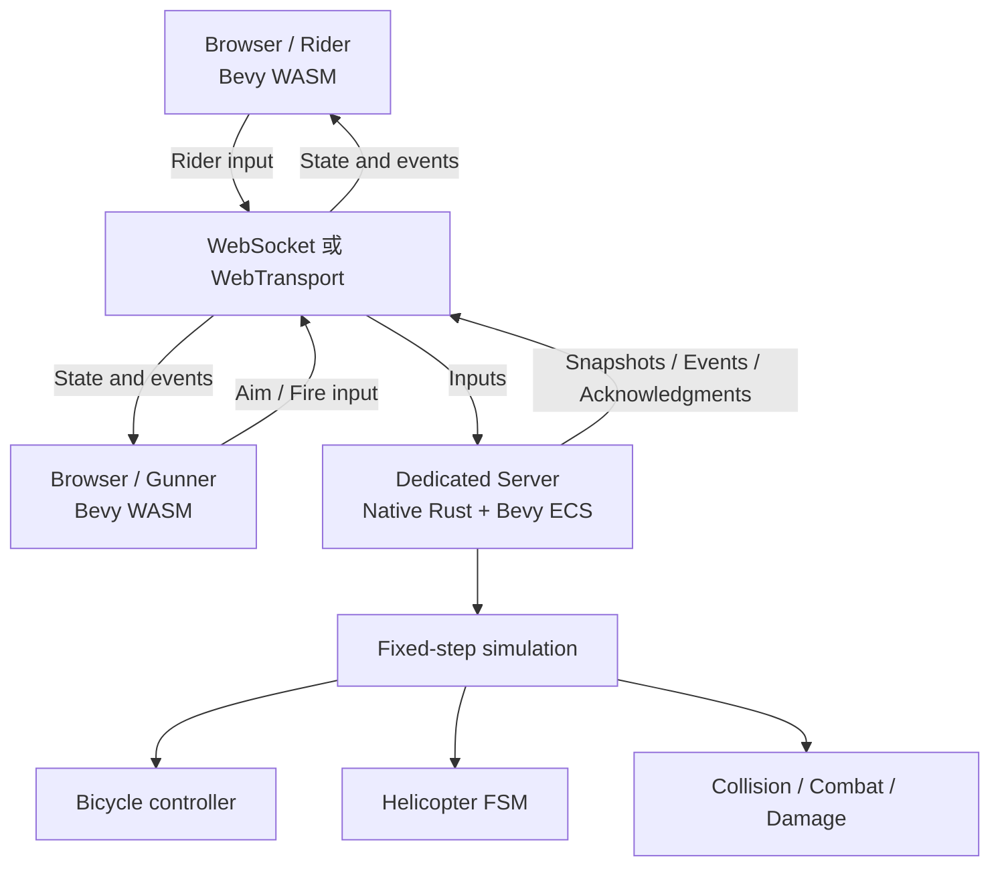
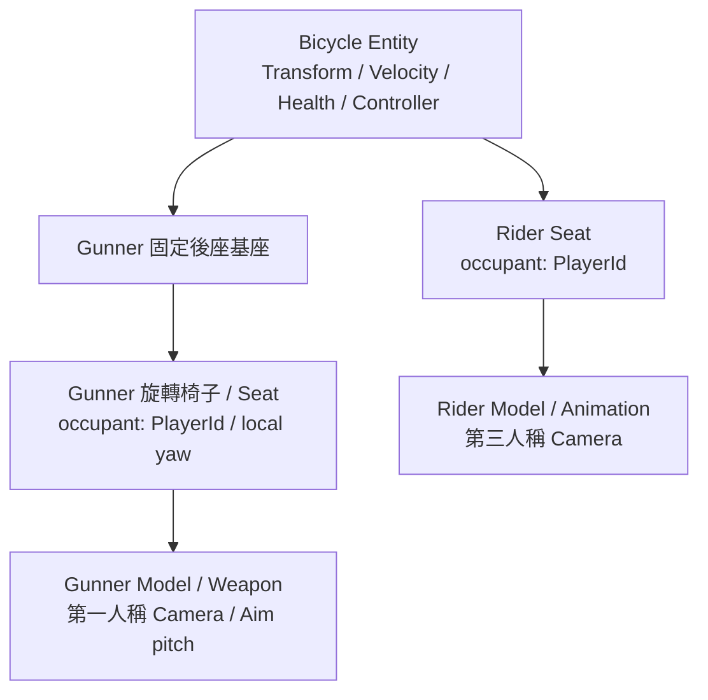
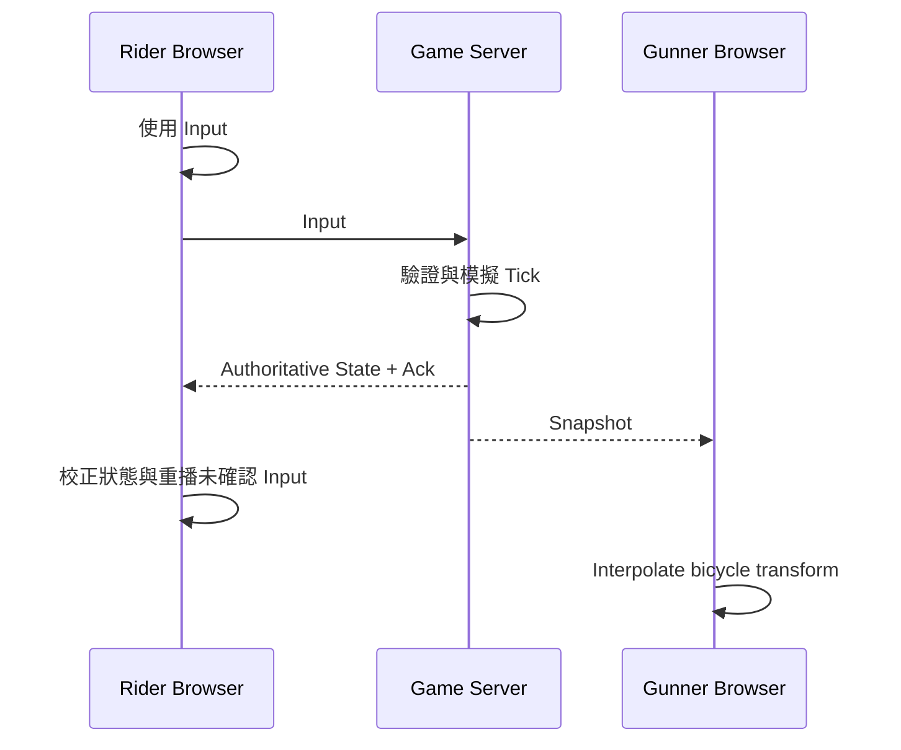
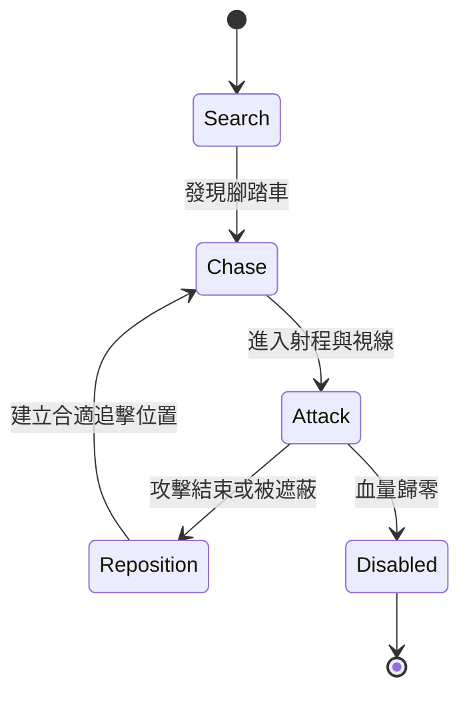
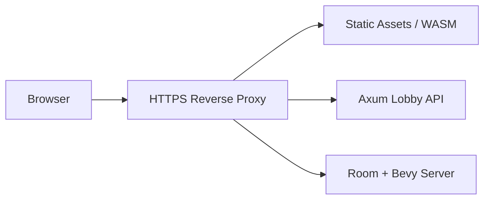

# Riverside Escape — Rust + Bevy 雙人合作遊戲架構指南

> 版本：0.8（概念設計 / MVP 技術規劃；轉向修正與 P5／P6 方向）
> 日期：2026-10-11  
> 目標：在瀏覽器中遊玩的台北河濱自行車雙人合作追逐遊戲

## 1. 專案定位

**Riverside Escape** 是一款 2 人合作、短局制、非對稱操作的 3D 追逐生存遊戲。玩家沿台北河濱自行車道逃亡；Rider 使用第三人稱視角騎車、閃避路障和直升機攻擊，Gunner 使用第一人稱視角，坐在日常腳踏車後座的可旋轉椅子上，以具有鎖定機制的防空武器反擊。敵方武裝直升機由遊戲伺服器上的 AI 控制，使用機槍和火箭持續施壓。

### 1.1 核心玩法

| 角色 | 主要工作 | 操作 | 關鍵設計 |
|---|---|---|---|
| Player 1 / Rider | 騎車、避障、選路 | 按住滑鼠左鍵踩踏；空白鍵煞車；按住右鍵移動滑鼠轉視角，放開回到 chase view；轉向按鍵待確認 | 第三人稱；騎乘操作與自由觀看分離 |
| Player 2 / Gunner | 瞄準、鎖定、反擊 | 滑鼠控制第一人稱視角／旋轉後座；按住右鍵瞄準，目標維持在準星周圍一段時間後鎖定，鎖定後才可發射；發射按鍵待確認 | 第一人稱；車手移動會影響視角與維持瞄準的難度 |
| Helicopter / AI | 追擊與攻擊 | 由伺服器決策 | 攻擊可預判、可閃避 |

**第一版完成條件**：Game Server 啟動後，兩名玩家透過網址連上同一 Room，分別操作同一台腳踏車的 Rider/Gunner 座位；兩人都按下 Ready 後，由 Server 開始 5 秒倒數，倒數結束才開始遊戲。玩家遭遇一架直升機，並在 3–5 分鐘內完成逃脫或擊落目標的遊戲循環。

### 1.2 MVP 不做什麼

- 不做大型開放世界、MMO、多伺服器 Sharding。
- 不先追求真實自行車平衡、輪胎或高精度飛行物理。
- 不做真實飛彈制導模型；以遊戲化鎖定與追蹤機制為主。
- 不先做玩家資料庫、商城、排名系統。
- 不先做台北河濱完整地理重建。

### 1.3 已確認規則與待確認細節

- 已確認：日常腳踏車搭配可旋轉的射手後座；Rider 第三人稱、Gunner 第一人稱；兩個角色的滑鼠右鍵用途不同。
- 已確認：Rider 按住左鍵踩踏、空白鍵煞車；按住右鍵轉視角，放開自動回到第三人稱 chase view。
- 已確認：Gunner 視角受腳踏車移動影響；按住右鍵瞄準，目標維持在準星周圍一段時間完成鎖定後才可發射。
- 已確認：兩名 Client 連線並各自 Ready 後，Server 倒數 5 秒再開局。
- 待確認：Rider 轉向按鍵、Gunner 發射按鍵、座椅水平旋轉與瞄準俯仰範圍、鎖定區域大小與所需時間。
- 待確認：離開準星區域、放開瞄準鍵、遮蔽或超出距離時，鎖定進度如何衰減／清除，以及完成鎖定後如何維持或解除。
- 待確認：Ready 能否取消、倒數期間斷線或取消 Ready 的處理方式；Running 期間斷線策略另見 §11。
- 本次更新聚焦程式與玩法規格；現有基本 mesh 可先供原型使用，日常腳踏車與旋轉椅子的模型調整留待後續。

## 2. 系統架構

**推薦方案：Browser 上執行 Bevy WASM Client，Linux 上執行原生 Rust + Headless Bevy Dedicated Server。**



### 2.1 Client 職責

- 3D Rendering、Camera、Animations、UI、Audio、VFX。
- 依 SeatKind 蒐集鍵盤、滑鼠操作；相同按鍵依 Rider／Gunner 角色產生不同語意，手把支援留待後續確認。
- 對本地 Rider 輸入做 Client-side Prediction；其他實體使用 Interpolation。
- Rider 的右鍵自由觀看與放開後回到 chase view 在本地處理，不改變車體轉向。
- Gunner 的第一人稱瞄準、座椅旋轉視覺與鏡頭立即反應，不等待網路往返；鏡頭仍受腳踏車移動影響。
- 顯示鎖定狀態、敵方攻擊預警、受擊提示及網路狀態。

### 2.2 Server 職責

- 維護權威世界狀態（Authoritative World State）。
- 驗證玩家座位權限及輸入（Rider 才能控制車輛，Gunner 才能開火）。
- 固定 Tick 模擬車輛、直升機、攻擊物件與碰撞。
- 驗證並累積 Gunner 的鎖定進度；尚未完成鎖定時拒絕發射。
- 管理兩名玩家的 Ready 狀態與 5 秒開局倒數，以 Server 時間決定遊戲開始。
- 決定命中、血量、勝敗、關卡進度、玩家斷線與重連。
- 發送 Snapshot、事件與輸入確認。

### 2.3 不採用 Server Rendering 的原因

一般雙人 3D 遊戲以 Client GPU 渲染較具成本與擴充性優勢。Server Rendering + WebRTC 的方案也可行，但需要伺服器 GPU、影片編碼與更高頻寬；只有在目標裝置無法順暢渲染遊戲時再評估。

## 3. 技術選型

| 模組 | 初版建議 | 注意事項 |
|---|---|---|
| 語言 | Rust | Workspace 共享協定與邏輯 |
| Game Engine | Bevy | 固定更新步驟 + ECS |
| Browser | WebAssembly | 測試 WebGPU / WebGL2 相容性 |
| Network Replication | Lightyear（候選） | 確認與 Bevy 版本相容，勿假設任意最新版可組合 |
| Physics / Collision | Avian（候選）或自訂 Kinematic | 初版以簡化碰撞為主 |
| 傳輸 | WebSocket 起步；視需要 WebTransport | WebSocket 更容易部署與除錯；Datagram 可評估延遲敏感項目 |
| Web API / Lobby | Axum + Tokio | 建房、邀請、Ready、Session 管理 |
| 服務部署 | Linux / Docker / Reverse Proxy | HTTPS、WSS、日誌與監控 |
| Persistency | MVP 無需資料庫 | 日後用 PostgreSQL 儲存帳號／成績 |

> **版本注意**：2026-10-11 的設計討論曾考慮 Bevy 0.19 + Lightyear 0.30 + Avian 0.7 作為相容性起點，亦提到 Bevy 0.20 已發布。正式建專案前，請以各專案當時的 release / compatibility matrix 和 WASM 範例實際驗證版本，將組合鎖定在 `Cargo.lock`。本文件不把這些版本視為永遠相容。

## 4. 專案結構與程式碼共享

```text
riverside-escape/
├── Cargo.toml
├── Cargo.lock
├── crates/
│   ├── common/
│   │   ├── components.rs       # 共用 ID、狀態、純資料結構
│   │   ├── protocol.rs         # Input / Snapshot / Game Event
│   │   └── game_config.rs      # Tick、移動與戰鬥常數
│   ├── simulation/
│   │   ├── bicycle.rs          # Kinematic vehicle
│   │   ├── helicopter.rs       # AI state machine
│   │   ├── combat.rs
│   │   └── collision.rs
│   ├── networking/
│   │   ├── replication.rs
│   │   └── transport.rs
│   ├── server/
│   │   ├── main.rs
│   │   ├── room.rs
│   │   └── session.rs
│   └── client/
│       ├── main.rs
│       ├── camera.rs
│       ├── input.rs
│       ├── ui.rs
│       └── effects.rs
├── assets/
│   ├── maps/
│   ├── models/
│   ├── sounds/
│   └── textures/
└── web/
    └── index.html
```

**共享原則**：

1. `common` 共享 Serialization、Component 定義、Game Rules Constants。
2. `simulation` 共享可重現的簡化移動計算，幫助 Client Prediction；但 Server 最終裁決。
3. `server` 不連結 Renderer、Audio 或 Browser API，使用 Bevy Headless Plugin 配置。
4. `client` 只擁有 Presentation 與預測所需的遊戲邏輯。絕不放入需要保密的伺服端資料或驗證密鑰。

範例：

```rust
use serde::{Deserialize, Serialize};

#[derive(Clone, Copy, Debug, Serialize, Deserialize)]
pub struct RiderInput {
    pub tick: u32,
    pub pedal_held: bool, // 按住滑鼠左鍵踩踏
    pub brake_held: bool, // 空白鍵煞車
    pub steer: f32,      // -1.0..=1.0；按鍵配置待確認
}

#[derive(Clone, Copy, Debug, Serialize, Deserialize)]
pub struct GunnerInput {
    pub tick: u32,
    pub yaw: f32,         // 相對腳踏車固定後座基座的座椅方位角
    pub pitch: f32,       // 相對旋轉座椅的瞄準俯仰角
    pub aim_held: bool,   // 按住滑鼠右鍵瞄準；不代表已鎖定
    pub fire_pressed: bool, // 發射請求；按鍵配置待確認
}
```

Rider 的右鍵自由觀看是 Client 相機狀態，不作為車體操控輸入傳送。Gunner 的座椅／瞄準方向會影響鎖定與發射，因此須傳給 Server 驗證。Ready 屬於 Room／Session 訊息，不放在高頻騎乘或瞄準輸入中。此處僅示意操作語意，正式協定仍需定義 Tick／Sequence、Ack 與可去重的發射請求 ID。

**驗證要點**：Server 必須 clamp 輸入、檢查 Tick 範圍、Fire Cooldown、彈藥、鎖定狀態、角色權限與 Room 狀態；不能相信 Client 上報的鎖定完成、擊中或血量。

## 5. ECS 與雙人共乘模型

**把日常腳踏車 Bicycle 作為唯一具物理位置的玩家載具 Entity**，Rider/Gunner 是它的不同 Seat；不是兩名各自獨立移動、再以物理 Joint 綁定的玩家。Gunner 後座包含可旋轉椅子，旋轉只改變射手座位與瞄準方位，不建立第二個獨立移動的載具。



概念性資料模型：

```rust
#[derive(Component)]
struct Bicycle {
    speed: f32,
    steering: f32,
    health: f32,
}

#[derive(Component)]
struct Seat {
    kind: SeatKind,
    occupant: Option<PlayerId>,
}

enum SeatKind {
    Rider,
    Gunner,
    Observer, // future expansion
}

#[derive(Component)]
struct Helicopter {
    state: HelicopterState,
    health: f32,
}
```

`PlayerId`、`HelicopterState` 需在實作中定義；上述範例是架構草圖，非完整可直接編譯的檔案。

### 5.1 Seat Transform

- Rider 座位與 Gunner 固定後座基座採腳踏車 Local Transform。
- Gunner 使用 `BikeWorldTransform × GunnerSeatBaseLocalTransform × ChairYawLocalTransform` 組合旋轉座椅姿態，再組合視線位置與 Aim Pitch 得到第一人稱鏡頭／武器方向。
- Gunner 的 Weapon/Aim Orientation 相對旋轉座椅座標系；車體位移與轉向會影響射手的世界視角，不自動維持原本的世界瞄準方向。
- 座椅方位旋轉與瞄準俯仰分開表達；角度範圍及車身傾斜影響鏡頭的程度待確認。
- 現有模型掛點可供原型對接；日常腳踏車與可旋轉後座模型稍後調整，不以現有長尾雙座模型限制程式資料結構。
- 第三位玩家可擴充新座位或新載具，不應改變 Bicycle Controller 的單一權威來源。

## 6. 騎乘與碰撞系統

### 6.1 先做 Arcade / Kinematic Bike

- 載具定位為日常腳踏車；初版仍採 Arcade / Kinematic 計算，不因此引入真實平衡或完整輪胎物理。
- 操作：按住滑鼠左鍵踩踏，空白鍵煞車，另有 Steer 輸入；限定最高速度和加速度。放開左鍵停止踩踏，與主動煞車區分；慣性／阻力參數及轉向按鍵待確認。
- 按住右鍵只改變 Rider 第三人稱觀看方向，放開回到 chase view；自由觀看不自動轉向腳踏車。
- 轉向：依當前速度調整轉彎半徑與橫向穩定度。
- PM 操控決策：停車時可轉前叉／手把，但整台車不原地旋轉；車身 yaw 隨行進速度及路徑曲率改變。視覺手把角與車體方向分開表達，低速到行進的轉向須連續，沿用 Client／Server 共用的簡化控制計算。
- 車身傾斜：優先做 Visual Lean，而非真實動力學平衡。
- 碰撞：簡化成 Capsule 或 Compound Colliders，障礙物碰撞扣血與減速。
- 第一期不做複雜輪胎接觸、真實倒車平衡或飛躍物理。

### 6.2 固定更新

建議初始測試值：

| 參數 | 預設 | 用途 |
|---|---:|---|
| Server simulation | 60 Hz | 16.67 ms/Tick |
| Network snapshots | 20 Hz | 50 ms/Snapshot |
| Client rendering | 視裝置而定 | 與 Server Tick 解耦 |
| 測試延遲 | RTT 50 / 100 / 200 ms | 調整 Prediction / Interpolation |

以上是測試起點，不是性能或操作品質保證值。正式規格須在真實瀏覽器、網路與裝置上調整。

### 6.3 操控研究參考：Drifter

使用者提供的參考位於 `jason9075@10.90.0.254:/home/jason9075/docs/study/dg/07-bike-handling.md`，標題為「07. Drifter 機車的操控系統」。筆記根據資產與執行檔反射整理，區分了「資料」「推論」與未取得數值的「C++ 預設」；它是協助減少設計錯誤的參考，並非本專案的實作規格或已驗證的物理模型。

**使用者已明確要求不用全部照抄。** 本專案仍遵循日常腳踏車、非對稱操作、單一權威車體與簡化 Kinematic 的既有規劃。以下是工程師評估操控時可參考的方向，不新增使用者已確認的玩法需求：

| 參考點 | 本專案評估方向 | 需避免的錯誤 |
|---|---|---|
| 速度敏感轉向 | 對照低速操控、高速轉彎半徑與方向變化速度，保留可調曲線 | 不直接套用機車的速度區間與轉向角數值 |
| 輸入變化率 | 評估數位踩踏／煞車是否需要漸變，讓按住、放開與主動煞車有可辨識的差異 | 左鍵與空白鍵是數位輸入，不把類比扳機曲線直接當成按鍵行為 |
| 傾斜與彈簧回正 | 評估視覺傾斜的進入／回正節奏；依目前簡化模型保持可控制的平衡 | 不因參考筆記而引入完整 PhysX 車輛、機車質量或懸吊參數；傾斜限制轉向須另行驗證 |
| 車身／乘員／頭部分層 | 對照車體、乘員與鏡頭的跟隨方式，避免額外抖動 | 保留車手移動對射手視角的影響；車身傾斜傳給鏡頭的程度仍待確認 |
| 撞擊門檻與冷卻 | 檢查持續接觸是否造成每 Tick 重複傷害，區分碰撞反應與傷害事件 | 不照抄機車衝量、血量、冷卻時間或落地傷害曲線；傷害仍由 Server 裁決 |
| 路面與鏡頭情境 | 後續需要多種路面或速度感時，再評估抓地力與鏡頭參數 | 不提前增加燃料、氮氣、漂移、排檔或改變已確認的右鍵／空白鍵用途 |

- 本專案使用公尺、秒、m/s；參考筆記中的 cm、cm/s 與角度數值需辨識單位，不能直接搬入。
- 影響車體移動的輸入平滑、轉向或碰撞計算，須由 Client 預測與 Server 共用；純視覺調整與權威模擬分開，避免兩端使用不同控制規則。
- 先對照現有控制器與 P0／P1 測試結果，列出具體問題、建議與取捨，再決定是否修改。評估可記錄起步反應、停止踩踏後的滑行、煞停距離、轉彎半徑與傾斜回正；不因新增參考而全面重寫物理系統。
- 所有引用的推論維持推論標記；調校選擇維持暫定標記，經本專案實測後才定案。

## 7. 網路同步設計

### 7.1 權威歸屬與同步對象

| 項目 | 權威來源 | 傳送內容 |
|---|---|---|
| 腳踏車 | Server | Transform、Velocity、Health、Ack Tick |
| Rider | Rider input → Server 驗證 | Pedal Held、Brake Held、Steer；自由觀看只在 Client 處理 |
| Gunner | Gunner input → Server 驗證 | Chair Yaw、Aim Pitch、Aim Held、Fire Request |
| 鎖定狀態 | Server | Target ID、Lock Progress、Locked；Client 可先顯示預估回饋 |
| Ready / 開局倒數 | Server | 各座位 Ready 狀態、Room State、Countdown End / Start Tick |
| 直升機 | Server AI | Transform、Health、Attack State |
| 火箭／飛彈 | Server | Spawn、關鍵校正、命中／爆炸 Event |
| 特效 | Client | 本地粒子、音效、畫面震動 |
| 靜態地圖 | Asset | Client 預載；不逐幀同步 |
| 可破壞障礙物 | Server | 破壞狀態 / Event |

### 7.2 Prediction / Reconciliation / Interpolation



- **Rider Client**：預測自己的腳踏車操作，收到 Server Ack 後 Reconcile。
- **Gunner Client**：第一人稱瞄準與座椅旋轉必須立即回饋；車輛姿態主要透過 Interpolation，並影響鏡頭位置與世界觀看方向，必要時利用近期輸入做有限 Prediction。平滑處理用來抑制網路校正造成的非預期跳動，不移除 Rider 移動本身對視角的影響。
- **其他實體**：Helicopter 與投射物可做 Interpolation 或依 Spawn 狀態局部模擬，Server 定期校正。
- **命中／傷害**：只由 Server 判定。可視需求設計 Lag Compensation，但第一版可先不用複雜歷史回溯。
- **WASM vs Native**：跨平台浮點與 Physics Engine 不必然完全決定性；使用近似預測與權威校正，不要求完全 Lockstep。

P1 校正驗收補充：

- Rider 的輸入確認須配合時間／Tick 對齊的權威校正與未確認輸入重播；若提出等效方案，需說明如何保留尚未反映在快照中的本地操作並驗證。僅清除已確認序號與平滑靠近過去快照，不算完成本指南的 Reconciliation。
- WebSocket 的有序可靠傳輸保障訊息交付，並不消除 Client 預測時間與 Server 快照時間的差異。這與是否採不可靠傳輸分開判斷；參考 [Valve 的 Client-side Prediction 說明](https://developer.valvesoftware.com/w/index.php?title=Latency_Compensating_Methods_in_Client%2FServer_In-game_Protocol_Design_and_Optimization&uselang=en)。
- 權威模擬狀態、Client 預測狀態與渲染平滑分開處理；視覺平滑不改寫權威規則。指標區分同 Tick 誤差、跨 Tick 狀態差、每幀校正與按實際時間計算的追趕延遲。
- 不能只以縮小單幀位移宣告體驗改善；還需驗證不同渲染幀率下的落後距離與收斂時間，並保留車手正常移動對射手視角的影響。

### 7.3 Transport 選擇

**MVP 建議先 WebSocket**，因為兩位玩家、開發與部署較單純。若測試發現 TCP Head-of-line Blocking 嚴重影響即時操作，再評估 WebTransport Datagram，或採可靠與不可靠訊息分流。

分辨訊息語意：

- `Input`: 高頻、包含 Tick 與 Sequence；可按傳輸特性合併／丟棄過期值。
- `Snapshot`: 最新狀態通常比過時狀態重要。
- `GameEvent`: 需要一致性與可追蹤 Event ID（如受擊、重生、遊戲結束）。
- `Lobby/Session`: 可靠訊息（建立房間、加入、Ready、角色分配、5 秒倒數與開始時間）；倒數以 Server 時間為準。

## 8. 直升機 AI 與戰鬥設計

直升機作為「追擊型 Boss」，追求節奏與可預判攻擊，不追求真實軍用火控。



### 8.1 機槍攻擊（遊戲機制）

- 先出現聲音或視覺 Telegraph（攻擊預告）。
- 使用可理解的掃射區域，不設定成永遠精準命中。
- 讓橋墩、堤防與道路轉角形成有效掩蔽。

### 8.2 火箭攻擊（遊戲機制）

- 發射前顯示警示區域和適當提示時間。
- Server 生成與驗證投射物、碰撞、爆炸和傷害。
- Client 處理音效、尾焰、爆炸粒子與畫面回饋。

### 8.3 射手鎖定武器

- Gunner 使用第一人稱視角，**按住滑鼠右鍵瞄準**；目標須維持在準星周圍的鎖定區域一段時間，才完成 Lock。
- 僅在按住瞄準鍵且目標符合鎖定條件時累積 Lock Progress；鎖定區域大小與所需時間尚未定案。
- Rider 的移動與轉彎會影響 Gunner 視角，可能使目標離開鎖定區域。急轉彎本身是否另設打斷規則尚未定案，不預設獨立的轉彎懲罰。
- 離開鎖定區域、放開右鍵、遮蔽物與距離的中斷／衰減規則，以及完成鎖定後的維持／解除條件待確認。
- **完成鎖定後才可發射**。Client 發送 Fire Request；Server 驗證權威鎖定狀態、冷卻、目標、彈藥、座位權限與 Running 狀態。發射按鍵尚未指定。
- Server 依有效的瞄準輸入與權威世界狀態累積、判定鎖定；Client 可提供即時預估 HUD，但不能自行宣告已鎖定。插值視角與 Server 判定的時間差處理仍需另外確認。
- Server 決定是否生成飛彈與命中結果；不實作真實武器導引參數。

### 8.4 P2 首批攻擊原型（PM 決策）

- 一架 Server 控制的直升機，僅在 Running 進行追擊、攻擊預告、攻擊與重新定位。
- 首批僅做空對地火箭；機槍及 Gunner 的鎖定反擊後續再接。落點與爆炸區域在預告顯示後固定，讓 Rider 有機會透過騎乘操作離開危險區。
- Rider chase view 顯示危險區與預告時間；Gunner 第一人稱提供威脅方向提示。預告時間、範圍與攻擊間隔先使用集中配置的暫定值，經玩法測試再調整。
- Server 生成火箭、模擬移動並結算爆炸／命中；以 Attack／Event ID 保持兩端一致並防止重複呈現或結算。
- 首批以受擊提示及次數紀錄驗證命中／閃避，不在 P2 宣告生命值、反擊或完整勝敗循環完成。
- 倒數前不攻擊；房間重設清除舊攻擊與預告。以一次命中、一次成功閃避、雙端一致性與既有 P1 不退化作為驗收重點。

### 8.5 P3 鎖定反擊原型（PM 暫定配置）

這些配置用於讓工程師驗證完整合作戰鬥，不是使用者已確認的正式按鍵、難度或平衡數值；正式調校與局長仍待玩家測試。完整範圍與驗收見 [`docs/PRODUCT_PLAN.md`](docs/PRODUCT_PLAN.md) 最新 P3 決策。

- Gunner 保持右鍵瞄準、左鍵按下發射一次；座椅水平可旋轉 360°，俯仰暫定 −45°～+75°，確保可以看見並對準追擊直升機。
- 準星周圍使用 6° 半角鎖定區域，距離不超過 120 m，目標無玩法碰撞體遮蔽時累積 2 秒。短暫離開區域最多容許 0.2 秒，期間暫停累積且不能發射；超時清零。放開右鍵、超距、遮蔽、斷線／切座或目標失效清零。
- Server 驗證當下鎖定與瞄準、有效輸入、座位權限、Running、2 秒冷卻及彈藥；每局暫定 6 發。受理後才扣彈，發射後需重新鎖定；重複請求不重複生成或扣彈。
- Server 模擬遊戲化追蹤飛彈並裁決命中。直升機暫定 100 耐久、玩家飛彈每次扣 34；腳踏車 100 耐久，敵方火箭命中每次扣 25。同一攻擊只結算一次，本批不增加障礙碰撞傷害。
- 本批以擊落為勝利、車體耐久歸零為失敗；同 Tick 兩者歸零暫定失敗優先。抵達逃脫終點待 P4。
- Finished 顯示結果並停止攻擊，清除 Ready；兩人重新 Ready 後重設並倒數 5 秒開始新局，保留 solo 測試。完整 Lobby／重連 UI 仍待 P5。
- 初版不做歷史回溯；本地瞄準立即反應，預估 HUD 與 Server 權威鎖定須可區分，拒絕發射提供清楚原因。100 ms 固定延遲下驗證雙端事件、耐久與勝敗一致。

## 9. Camera / UX

### Rider Camera

- 腳踏車後上方第三人稱視角；依速度調整 Camera Follow / FOV。
- 預設為第三人稱 chase view。按住滑鼠右鍵時，可移動滑鼠繞車轉視角；放開右鍵後自動回到 chase view，回正速度／平滑參數待調整。
- 自由觀看與車體轉向分離；按住右鍵觀看時仍可按住左鍵踩踏或使用空白鍵煞車。
- 保持障礙物與地面預警可視性。
- 急轉彎需有適度 Camera Smoothing，但不可造成過重操控延遲。

### Gunner Camera

- 使用**第一人稱視角**，鏡頭位於射手視線位置；滑鼠控制旋轉椅子的觀看方位與瞄準俯仰，立即在本地回應。
- 鏡頭隨腳踏車位移／轉向與座椅旋轉改變，車手移動會影響射手視角；不預設為固定世界方向的穩定鏡頭。
- 按住滑鼠右鍵進入瞄準、在準星周圍維持目標以累積鎖定；是否縮小 FOV 或改變滑鼠靈敏度待確認。
- HUD：鎖定進度、目標方位、冷卻時間、剩餘彈藥。
- 可平滑插值／校正造成的非預期抖動，但保留腳踏車移動對視角的玩法影響；車身傾斜傳遞程度待確認。

### 兩人合作設計

- Rider 的危險閃避可能干擾 Gunner 的鎖定。
- Gunner 可以告知直升機位置與威脅方向。
- 可後續增加簡易 Ping / Warning UI，減少非語音玩家的溝通障礙。

## 10. 地圖與素材串流

第一版製作 **1–2 公里、3 段特色區域的河濱路線**，用虛構布局重現台北河濱意象，而非直接重建整條河岸：

1. **開闊河岸**：直升機具攻擊優勢，迫使玩家高速閃避。
2. **橋下道路**：利用橋墩遮蔽並穿越障礙。
3. **狹窄彎道**：更重視騎車路線、減速和精準操作。

### 10.1 地圖技術

- Spline-based Road 搭配分段 Chunk。
- 結合關卡手工配置障礙、橋墩、轉角與 Enemy Encounter Trigger。
- 靜態場景在 Client 載入，Server 使用必要的簡化 Collision Data。
- 若大型素材導致初始讀取時間太長，才增加 Asset Streaming。
- 模型與貼圖使用 glTF / GLB、Mipmaps、LOD；壓縮格式與 KTX2 支援必須以目標瀏覽器及 Bevy 版本驗證。

### 10.2 P4 路線與逃脫原型（PM 暫定方向）

P3 原型工程驗收通過後，以約 1.2 km 的單一路線串接開闊河岸、橋下掩體與狹窄彎道。這是可調原型，尚未確認正式難度、配置與局長；交付分批驗證並各自 commit，完整驗收見 [`docs/PRODUCT_PLAN.md`](docs/PRODUCT_PLAN.md) 最新 P4 決策。

- 共用關卡資料定義道路、簡化碰撞／遮蔽、起點、順序檢查點與終點；Client 視覺、Rider 預測與 Server 使用相符資料。Server 不載入渲染資產。
- 維持自由騎乘，不吸附路線中心線。彎道應能用既有控制器通過，護欄與障礙的可見位置需對應碰撞；舊短跑道的世界邊界須隨關卡調整。
- 橋面與橋墩形成真正掩體，阻擋敵我視線、鎖定與投射物。敵方失去視線時追蹤／重新定位；直升機不能穿越掩體，已發射投射物撞掩體後不穿透造成車體傷害。
- 保留擊落勝利，新增「依序通過檢查點並抵達終點」的逃脫勝利，皆由 Server 裁決並回報原因。同 Tick 耐久歸零時失敗優先；漏檢查點或只接近終點不算完成。
- HUD 提供區段與剩餘路程／終點方向；重玩回起點並清除路線進度、攻擊、鎖定與預測歷史，仍走雙方 Ready 與 5 秒倒數。
- 本批沿用素材與簡化幾何，不新增障礙碰撞傷害或正式 Lobby。先驗證完整路線與既有戰鬥共存，再調校 3–5 分鐘局長。

### 10.3 Browser / WASM 限制

- WebGPU / WebGL2 可用性、Shader、Texture Format、GPU Limits 因平台而異。
- 部分 Rust Crate 使用 Native APIs，WASM 不一定能編譯。
- 分頁在背景時，Browser 可能限制更新頻率；Server 不應依賴 Client 持續模擬。
- 壓縮 WASM、使用 CDN Cache 與帶版本 Asset URL，減少重複下載。
- 需要測試不同桌面 Browser 和低階 GPU；手機支援可列為後續階段。

## 11. Room / Lobby / 連線生命週期

Game Server 啟動 → 兩名 Client 連線並加入同一 Room → 分配／選擇 Rider / Gunner → 兩人各自按 Ready → Server 倒數 5 秒 → 開始 → 遊戲結束 → 再玩一局。

### 11.1 Room 狀態

```text
WaitingForPlayers → ReadyCheck → Countdown (5 seconds) → Running → Finished → WaitingForPlayers
```

- 以單一 Server Process 管理少量 Rooms，每個 Room 擁有獨立 World / Simulation Instance。
- Room 有唯一 ID，支援邀請碼或 URL。
- Session 對應 PlayerId 與 Seat，避免另一名玩家假冒角色控制輸入。
- 本版必需座位為 Rider 與 Gunner；兩個座位都由已連線玩家佔用後進入 ReadyCheck。以必需座位集合檢查開局條件，避免把 `player_count == 2` 寫死在共用架構。
- 每名玩家須各自按 Ready；兩個必需座位都 Ready 後，Server 才進入 Countdown，倒數固定 5 秒。
- Server 發送倒數結束／開始的權威時間或 Tick，兩端據此顯示倒數；由 Server 在倒數結束時切換至 Running，不依靠 Client 自行倒數來決定開局。
- WaitingForPlayers、ReadyCheck 與 Countdown 不推進正式騎乘／戰鬥，Server 在 Running 前不接受會改變遊戲狀態的踩踏、煞車或發射操作；Client 可處理本地觀看。
- 倒數結束進入 Running 前仍需滿足連線、座位與 Ready 條件；倒數期間斷線、取消 Ready、重連後是否重新 Ready 的具體轉移策略待確認。
- Rider 斷線時可暫停或保守煞車；Gunner 斷線時可暫停或由 Rider 繼續逃亡。具體策略以玩法測試決定。
- 短時間保留玩家席位並支援 Reconnect Token。

### 11.2 P5 生命週期決策（PM 暫定方向）

使用者要求先修正 A／D，再繼續 P5／P6。車手前進時 A 向車體左側、D 向右側轉，前叉與車頭顯示亦一致；自由觀看不改變車體相對語意。完整工作範圍與驗收以 [`docs/PRODUCT_PLAN.md`](docs/PRODUCT_PLAN.md) 最新決策為準，下列決策取代 §11.1 的待確認策略。

- 同一 Server 初版支援最多 4 個活躍房間；建立／加入邀請碼或網址、原子選座、可點擊 Ready／取消 Ready 與離房 UI。房間的世界、事件、座位與狀態隔離，無玩家且無保留席位 10 分鐘後清理。
- 換座清除雙方 Ready；開局倒數中取消 Ready 或斷線取消倒數並清除 Ready，重新準備後完整倒數 5 秒。正式 Running 不換座，開發 solo 維持獨立 R／V 流程。
- Running 任一必需座位斷線時只暫停該房間，清輸入、鎖定、預告與投射物，不退款已花費彈藥；保留位置、耐久、彈藥、路線進度，暫停玩法時間與冷卻。
- 原席位牆鐘保留 30 秒，房間／玩家專屬不可猜測的 Reconnect Token 只存該分頁 session storage，不進邀請網址。刷新／短斷線可恢復，拒絕跨房間 token 與雙 socket 控制。
- 重連後兩人重新 Ready，再走 5 秒恢復倒數，保留本局資源；重建 Client 預測歷史，恢復後重新追擊與預告。逾期或 Running 主動離房顯示對局中止，釋放席位，可邀新人開新局。
- 結果與 HUD 區分逃脫／擊落／耐久歸零／中止，顯示連線與操作狀態；使用可讀繁體中文，不依賴只供工程師看的快捷鍵或診斷文字。

### 11.3 第三名玩家的擴充方式

用 `SeatKind` 與 Capability/Permission 的概念擴充，而不要在全系統硬編碼 `player_count == 2`。

第三名角色可為 Observer / Navigator、另一台載具的駕駛，或提供預警的偵察手。增加角色前應確認是否仍維持單一 Bicycle Entity 的設計。

## 12. 部署與安全



- HTTPS + WSS（或 WebTransport 對應安全設定）為正式部署基礎。
- Web API 可與 Game Server 共處同一程式，也可分離，但 MVP 沒必要微服務化。
- 伺服器端驗證座位、輸入頻率、射擊冷卻、所有狀態變化。
- 限制封包尺寸、連線速率、Room 人數與無效輸入；不要在 Client 放入密鑰。
- 記錄 RTT、Jitter、Packet Loss / Retry、Tick Duration、Snapshot Bytes、Disconnects。
- 使用版本固定、CI build / test、Headless Integration Tests；容器化只是部署方式，不等於每個 Room 都要開一個容器。

## 13. 實作里程碑

| 階段 | 內容 | 可驗收標準 |
|---|---|---|
| **P0** | 日常腳踏車的簡化操控、簡單 3D 跑道、Rider 第三人稱鏡頭 | 左鍵踩踏、空白鍵煞車；右鍵轉視角，放開回到 chase view；能轉彎與撞障礙物 |
| **P1** | Dedicated Server、雙人連線、共用車體、非對稱視角、最小 Ready 流程 | 兩端分別為 Rider 第三人稱／Gunner 第一人稱；射手旋轉後座，視角受車體移動影響；兩人 Ready 後 Server 倒數 5 秒再開始 |
| **P2** | 直升機 FSM、追擊與可預警攻擊 | 直升機追車、掃射或投射攻擊、玩家能迴避 |
| **P3** | Gunner 右鍵瞄準、鎖定、發射、傷害與擊落 | 準星周圍維持目標一段時間後才可發射；Server 權威驗證鎖定、發射、生命值與勝敗，兩端事件一致 |
| **P4** | 河濱場景、橋墩、彎道、障礙 | 可遊玩完整 1–2 公里路線 |
| **P5** | 完整 Lobby / Room UI、重連、HUD、勝負循環 | 兩人可建立房間、邀請、Ready、倒數、完成與重玩一局；P1 的最小開局流程擴充為完整生命週期 |
| **P6** | 網路壓力與瀏覽器相容性測試 | 在指定 RTT/Jitter 條件下仍能可接受地操控與瞄準 |

### 13.1 P1 的最關鍵測試

可先用既有基本 mesh 或簡單方塊作為占位，不等待模型調整。觀察不同網路延遲下 Rider 快速轉向時，Gunner 第一人稱 Camera/Aim 是否出現額外網路跳動；腳踏車移動造成的觀看方向改變屬已確認玩法，不當成必須消除的誤差。

另驗收 Rider 右鍵自由觀看與放開回到 chase view，以及兩個 Client 各自 Ready 後的 5 秒倒數：未全部 Ready 不開局，正式遊戲不在倒數結束前推進，開始時刻由 Server 統一決定。

應記錄：

- Rider 本地 Input-to-Visual Latency。
- Gunner 看到的腳踏車位置延遲與抖動。
- Client 位置校正距離（Position Correction Error）。
- 快速轉向時瞄準線的變化，區分預期的車體影響與插值／校正造成的非預期抖動。
- Server Tick 用時與網路封包量。

**建議網路模擬**：測試 RTT 50 / 100 / 200 ms，加上不同 Jitter 與適度 Packet Loss。記錄結果後再選擇 Prediction / Snapshot Rate，而不是僅憑理論決策。

### 13.2 P6 原型工程驗證範圍

- 桌面鍵鼠／WebGL2，先測 Chrome／Chromium 與 Firefox；版本及環境據實記錄。手機與 Safari 不在本批承諾。
- 覆蓋 0／50／100／200 ms RTT，以及 100／200 ms RTT 加每方向 ±20 ms 可重現 jitter；另外針對隔離測試連線評估 1% TCP packet loss 與短斷線。不可用應用層丟訊息冒充封包遺失，也不改主機全域網路。
- 同 Tick 誤差、輸入 Ack、Gunner 狀態年齡與額外校正、事件唯一性及重連皆要有證據。受控呈現頻率下，放開／煞車後 1 秒內連續三份快照同 Tick 位置誤差低於 2 cm、Ack 排空，非長斷線不 history miss。
- 4 房間／8 玩家至少 10 分鐘負載，原型目標 tick duration p95 < 8 ms、p99 < 16.7 ms，記錄快照頻率／大小、記憶體及 Session／房間清理。
- 實體 GPU 才驗證 frame time／瞄準體驗；原型目標 p95 frame time < 33.3 ms。沒有可測硬體或瀏覽器時標明未驗，不以 SwiftShader 宣告正式體驗通過。
- 先修具體驗證失敗，再重測受影響範圍。報告、支援範圍、未驗清單及功能／修正 commits 統一交付；正式難度與平衡仍需玩家測試。

## 14. 架構決策紀錄（ADR）

| 決策 | 選擇 | 理由 | 重新評估條件 |
|---|---|---|---|
| Render Location | Client WASM | 降低 Server GPU 成本 | 低階裝置無法運行 |
| Game Authority | Server | 一致性、防作弊 | 只剩純單人離線模式 |
| Bicycle Model | 單一 Vehicle + Seats | 簡化多人共乘與物理同步 | 多台載具或離車玩法 |
| Vehicle / Seats | 日常腳踏車 + 可旋轉射手後座 | 符合共乘設定；旋轉座椅沿用單一車體權威 | 模型調整或座位旋轉範圍定案 |
| Cameras / Controls | Rider 第三人稱、Gunner 第一人稱；非對稱操作 | 騎乘與瞄準分工，車手移動影響射手視角 | 操作測試顯示需要調整 |
| Lock / Fire | 按住右鍵，準星周圍維持目標一段時間後才可發射；Server 驗證 | 鎖定需要持續瞄準，兩端狀態由 Server 裁決 | 鎖定參數與解除規則定案 |
| Match Start | 必需座位都連線並 Ready 後，Server 倒數 5 秒 | 玩家主動準備，開始時刻一致 | 斷線與取消 Ready 策略定案 |
| Physics Style | Arcade / Kinematic | 快速迭代遊戲手感 | 玩法依賴擬真力學 |
| AI | FSM | 一架敵方直升機已足夠 | 敵人數量與行為複雜度提高 |
| Transport | WebSocket 優先 | 成熟、易部署、易除錯 | HOL Blocking 影響操作 |
| Sessions | 少量 Room / 單 Process | MVP 維運簡單 | 房間數量、負載顯著增加 |
| Database | MVP 不導入 | 不影響核心玩法驗證 | 需要帳號、排行榜或持久化 |

## 15. 建議的下一個工程任務

1. 鎖定 **Bevy + Networking + Physics** 的版本矩陣，驗證 Linux Native Server + Browser WASM Client 同時編譯與運行。
2. 建立 Cargo Workspace、Headless Server Entry Point、WASM Client Loader。
3. 使用既有基本 mesh 或方塊建立平面原型，驗證 Rider 左鍵踩踏、空白鍵煞車與右鍵自由觀看／回到 chase view；模型調整留待後續。
4. 接上 Input Sequencing、Snapshot、Correction Metrics。
5. 讓兩個 Browser 加入同一 Room，接上非對稱視角、Gunner 旋轉後座與兩人 Ready 後的 5 秒倒數。
6. **優先驗證 Gunner 第一人稱瞄準的即時性與車體移動影響**，抑制非預期網路抖動；接著驗證右鍵維持目標、Server 鎖定與鎖定後發射，再擴充模型與更複雜玩法。

---

## 參考專案與連結

- Bevy: https://bevyengine.org/
- Bevy examples: https://bevy.org/examples/
- Lightyear: https://github.com/cBournhonesque/lightyear
- Avian: https://github.com/Jondolf/avian
- MDN WebTransport: https://developer.mozilla.org/en-US/docs/Web/API/WebTransport
- MDN WebAssembly: https://developer.mozilla.org/en-US/docs/WebAssembly

> 本文件屬架構設計草案；範例程式碼為概念片段，尚非可直接執行的完整遊戲。引擎與 Plugin 相容性、Browser 功能、效能與玩家體驗均需要實測。
